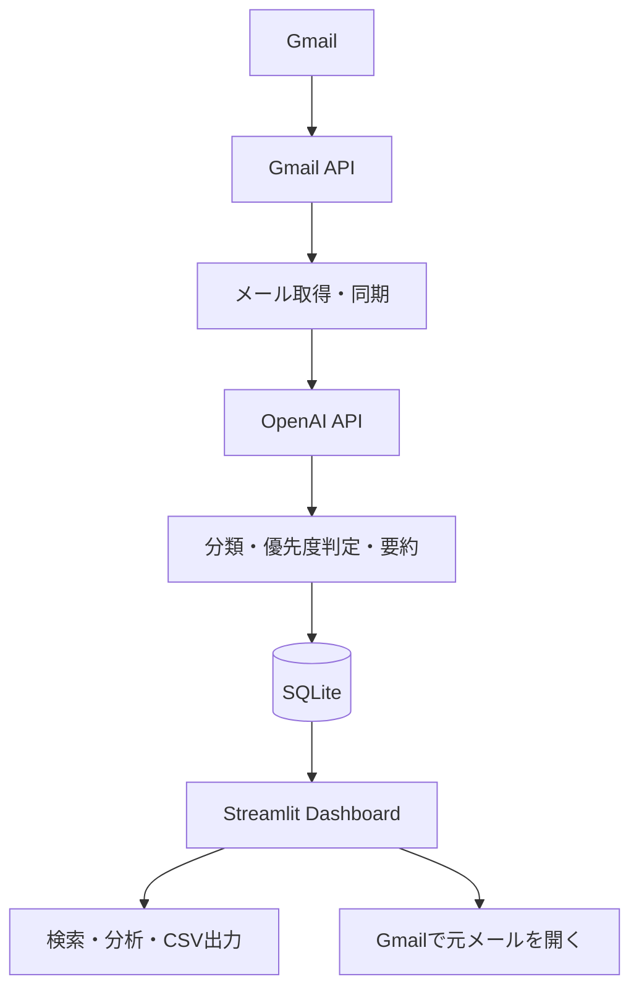

# AI Mail Manager

**Gmail連携と生成AIによるメール自動分類・優先度判定・問い合わせ管理システム**

Built with Python, Streamlit, OpenAI API & Codex

---

## 📌 プロジェクト概要

AI Mail Managerは、企業の問い合わせ対応業務を効率化するために開発したWebアプリケーションです。

Gmail APIを通じてメールを直接取得し、生成AIによって問い合わせ内容の分類、優先度判定、要約、推奨対応の生成を行います。

分類結果はダッシュボードで一覧管理でき、元のGmailへのリンクから該当メールを直接確認できます。

## 🎯 開発背景

企業の問い合わせ対応では、大量のメールを一件ずつ確認し、内容の分類や対応の優先順位を判断する必要があります。

こうした作業にかかる時間を削減し、重要な問い合わせへの対応に集中できる環境をつくることを目的として開発しました。

特に、CSVファイルへの手動変換を不要にするため、Gmail APIとの直接連携を採用しました。

## 🚀 主な機能

- **Gmail連携**：OAuth 2.0認証によるメール取得・同期
- **AI自動分類**：OpenAI APIによる問い合わせカテゴリの判定
- **優先度判定**：緊急度に応じた高・中・低の分類
- **AI要約**：メール内容の要約と推奨対応の生成
- **ダッシュボード**：分類結果やカテゴリ別件数の可視化
- **検索・絞り込み**：カテゴリ、優先度、送信者などによる検索
- **Gmailリンク**：該当メールをGmailで直接開く機能
- **重複防止**：SQLiteによるメールIDを使った重複登録防止
- **CSV出力**：分類結果のダウンロード
- **デモモード**：架空データを用いた動作確認

## 🛠 使用技術

| 分野 | 技術 |
|---|---|
| 言語 | Python |
| Web UI | Streamlit |
| 生成AI | OpenAI API / Structured Outputs |
| 外部連携 | Gmail API / OAuth 2.0 |
| データ管理 | SQLite / pandas |
| データ検証 | Pydantic |
| テスト | pytest |
| AIコーディング支援 | ChatGPT / Codex |
| バージョン管理 | Git / GitHub |

## 🏗 システム構成



## 🤖 AIコーディングツールの活用

本プロジェクトでは、ChatGPTとCodexを活用して開発を進めました。

### ChatGPT

- 業務課題の整理
- 初期プロトタイプの作成
- システム設計の検討
- 追加機能の要件整理

### Codex

- Gmail API連携機能の実装
- OAuth認証処理の実装
- OpenAI APIとの連携
- Streamlit管理画面の改善
- データベース処理の実装・改善
- テストコードの整備

### 開発上の工夫

**1. CSVアップロードからGmail直接連携への改善**

初期段階ではCSVをアップロードする方式でしたが、実際の業務ではCSVへの変換作業自体が負担になると考え、Gmailから直接メールを取得する方式へ変更しました。

**2. 専門知識がなくても使えるUI**

当初はGmail検索クエリを直接入力する必要がありました。

そこで、日本語のプルダウンメニューを採用し、利用者が取得対象を直感的に選べるよう改善しました。

**3. 再同期時の重複防止**

同じメールを繰り返し取得した場合でも重複登録されないよう、GmailのメールIDを利用した管理方式を採用しました。

**4. AIが利用できない場合への対応**

APIキーが設定されていない場合でも、ルールベースの分類や架空データのデモを利用できる構成にしています。

## 💻 ローカル実行方法

### 1. リポジトリの取得

```bash
git clone https://github.com/YOUR_USERNAME/ai-mail-manager.git
cd ai-mail-manager
```

### 2. 必要なライブラリのインストール

```bash
python -m pip install -r requirements.txt
```

### 3. Gmail APIの設定

Google Cloud ConsoleでGmail APIを有効化し、OAuth 2.0のデスクトップアプリ用クライアントを作成します。

取得したJSONファイルを `credentials.json` としてプロジェクト内の指定場所に配置します。

必要な権限：

`https://www.googleapis.com/auth/gmail.readonly`

※ 認証情報はGitHubにアップロードしないでください。

### 4. アプリの起動

```bash
python -m streamlit run app/ui.py
```

起動後、ブラウザで以下にアクセスします。

`http://localhost:8501`

### 5. 動作確認

架空データのデモモードでは、Gmail認証なしで画面を確認できます。

実際のGmail連携を使用する場合は、Google OAuth認証を完了し、メール同期を実行してください。

OpenAI APIによる分類には、別途APIキーの設定が必要です。

## 🧪 テスト

```bash
python -m pytest -q
```

Gmail APIやOpenAI APIの外部通信は、モックを用いて検証できる設計です。

実際のGmailアカウントを利用した接続テストは、別途OAuth設定を行って確認する必要があります。

## 🔐 セキュリティ

- Gmailへのアクセスは読み取り専用権限を使用
- OAuth認証情報やAPIキーをソースコードから分離
- 認証ファイルをGit管理対象から除外
- GmailのメールIDによる重複登録防止
- 架空データによる安全なデモ環境
- 実メールの外部AI送信について利用者の同意を考慮

## 📈 今後の改善予定

- メール分類精度の定量評価
- 問い合わせ対応状況の管理
- AIによる返信文案の生成
- 担当部署への自動振り分け
- 複数ユーザーへの対応
- 認証・アクセス制御の強化

## 📄 プロジェクトについて

本プロジェクトは、AIコーディングツールを活用したアプリケーション開発のポートフォリオとして制作しました。

単にAIでコードを生成するだけでなく、利用者の業務を想定した課題設定、機能設計、実装、検証、改善までを重視しています。

※ 本アプリは試作段階であり、本番業務への導入を保証するものではありません。

