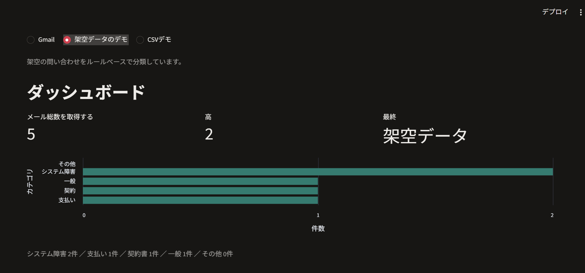
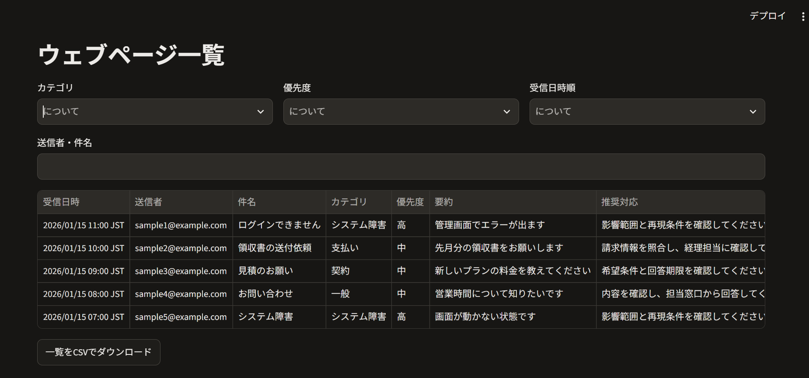
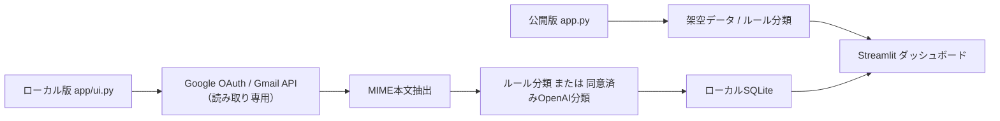

# AI Mail Manager

メールで届く問い合わせを、確認・分類・優先順位付け・一覧化するためのStreamlitアプリです。応募ポートフォリオとして、公開版は**架空データだけ**を用いる安全なデモに限定しています。

公開デモ: [https://ai-mail-manager-masahiro.streamlit.app/](https://ai-mail-manager-masahiro.streamlit.app/)

## スクリーンショット

### ダッシュボード



### 問い合わせ一覧



## 開発背景

問い合わせ窓口では、メールを読み、内容と緊急度を判断し、管理表へ転記する作業が繰り返されます。AI Mail Managerは、この最初の仕分けを支援し、対応漏れの防止と優先順位の共有を目指して作成しました。AIの判断をそのまま確定せず、分類理由・推奨対応を確認し、担当者がカテゴリと優先度を修正できる設計です。

## 業務上のメリット

- 問い合わせをカテゴリ・優先度で可視化し、障害や緊急案件を先に確認できる
- 検索・フィルター・CSV出力により、対応状況の共有や転記作業を軽減できる
- Gmailの読み取り専用連携、重複防止、分類根拠の表示により、確認可能性を保てる
- 公開デモは外部サービスに接続せず、採用担当者が安全に操作を試せる

## 公開デモ

Streamlit Community Cloudでは `app.py` を起動します。この入口は `run_app(public_demo=True)` を明示的に呼び、架空データ画面だけを表示します。

- Gmail OAuth、Gmail API、OpenAI APIは公開デモから呼び出しません
- 認証ファイル、APIキー、トークン、実メール、SQLiteデータベースはリポジトリに含めません
- 検索、単一選択のカテゴリ・優先度フィルター、日時順の並び替え、手動修正、CSV出力を操作できます

## 機能

| 区分 | 内容 |
| --- | --- |
| 公開デモ | 架空の問い合わせ5件、ダッシュボード、検索、絞り込み、編集、CSV出力 |
| ローカルGmail連携 | 読み取り専用OAuth、対象メールの選択、20/50/100件の手動同期 |
| 分類 | ルール分類を標準とし、明示同意がある場合だけOpenAI Structured Outputsを利用 |
| 保存 | SQLiteでGmailアカウントとmessage IDごとに重複を防止 |
| 追跡 | GmailスレッドへのリンクとMessage-ID検索リンク、分類理由、分類元を表示 |

## アーキテクチャ



公開版とローカル版の入口を分離し、公開環境では外部データに到達する画面自体を表示しません。

## 使用技術

- Python 3.12 / Streamlit / pandas
- SQLite
- Google OAuth 2.0・Gmail API（ローカル版、`gmail.readonly` のみ）
- OpenAI Responses API Structured Outputs / Pydantic（ローカル版、明示同意時のみ）
- Beautiful Soup（HTMLメール本文のテキスト化）
- pytest / Streamlit AppTest

## ローカルでの起動

### 公開デモと同じ安全な表示

```powershell
py -3.12 -m venv .venv
.\.venv\Scripts\python.exe -m pip install -r requirements.txt
.\.venv\Scripts\python.exe -m streamlit run app.py
```

### Gmail連携を含むローカル版

`credentials.json` を配置し、必要時のみ `OPENAI_API_KEY` を環境変数へ設定したうえで、次を実行します。認証情報やキーはGitに追加しません。

```powershell
.\.venv\Scripts\python.exe -m streamlit run app/ui.py
```

Gmail連携は読み取り専用です。取得するメールを選択し、同期時にだけAPIを呼びます。OpenAI分類は初期状態でオフであり、チェックボックスで同意した場合だけ、件名と本文の一部を送信します。

## 操作手順（公開デモ）

1. ダッシュボードでカテゴリ別件数と高優先度件数を確認します。
2. 「送信者・件名で検索」、カテゴリ、優先度、受信日時順で絞り込みます。
3. 「詳細・分類修正」から1件を選び、カテゴリ・優先度を変更して保存します。
4. 「一覧をCSVでダウンロード」で架空データの一覧を出力します。

## テスト

```powershell
.\.venv\Scripts\python.exe -m pytest -q
```

Gmail APIとOpenAI APIはモック化して検証します。OAuthスコープ、認証エラー、MIME/HTML解析、リンク生成、重複同期、途中失敗後の再開、AI同意制御、公開デモ切替、検索クエリ変換、デモ画面の検索と編集をテスト対象としています。

## セキュリティと公開前チェック

`.gitignore` は次を除外します：`credentials.json`、`client_secret*.json`、`token*.json`、`.env*`、`.streamlit/secrets.toml`、SQLite、CSV出力、`private/`、`.venv/`、キャッシュ。

公開前に必ず実行してください。

```powershell
git init
git add --dry-run .
git status --ignored
git log --all --oneline
git grep -n -I -E "AIza|sk-[A-Za-z0-9]|client_secret|refresh_token" $(git rev-list --all)
```

この作業時点ではGitリポジトリが未初期化で、既存のGit履歴はありません。最初のコミット前に上記で機密情報がステージ対象外であることを確認してください。万一キーをコミットした場合は、履歴から消すだけでなく、Google/OpenAI側で直ちに失効・再発行してください。

## Streamlit Community Cloudへのデプロイ手順

1. GitHubで新規の**Public**リポジトリを作成します（例：`ai-mail-manager`）。
2. このフォルダで公開前チェックを行い、`credentials.json`、`.env`、`private/`、`.venv/` が含まれないことを確認してコミット・pushします。
3. [Streamlit Community Cloud](https://share.streamlit.io/) でGitHubを接続し、「Create app」を選びます。
4. リポジトリ、ブランチ、Main file path に **`app.py`** を指定してデプロイします。
5. Secretsは登録しません。公開版はキーも認証も使いません。
6. 発行URLをシークレットウィンドウで開き、タイトル、架空データ、検索、編集、CSV出力を確認します。

Community CloudではGmail連携を有効化しないでください。ローカル版だけが実メールを扱う設計です。

## ChatGPT・Codexの活用

ChatGPTは、既存CSVデモに対する要件整理、READMEとテストの初稿作成に利用しました。Codexは、既存コードの調査、Gmail読み取り専用OAuth・SQLite保存・Streamlit画面・公開用デモ入口の実装、検索クエリの選択UI、モックを使ったpytestの追加と検証に利用しました。最終的な機能選択、認証情報の管理、公開判断は開発者が行います。

## 制限事項

- 公開デモは架空データ専用であり、実メールを扱いません。
- GmailとOpenAIの実連携、Gmailリンク遷移はローカル環境・テスト用アカウントでの手動確認が必要です。
- 共有利用、定期同期、メール返信・削除、DB暗号化、添付ファイルの取得は対象外です。
